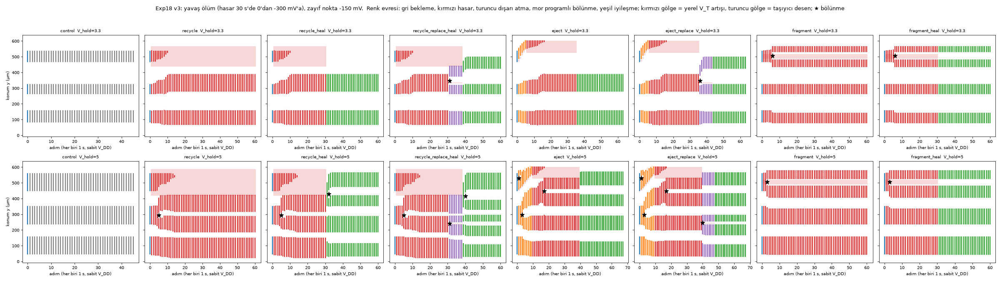

# Deney 18: Programlanabilir hücreler — doğum yerini seçmek, bilinçli hasar, ayıklama ve yenilenme

Tarih: 2026-10-15. Model: Exp17'nin filaman modeli (geniş SKY130 nFET, indirgenmiş 4 K modeli, dağıtık drenaj balastı,
λ = 60 µm, r_D = 10 Ω/µm, R_L = 5 kΩ, W = 600 µm, referans aygıt seti).

- **Kod:** `experiments/exp18_programmable/`
  - `run18.py`: doğum yeri koşuları;
  - `predict18.py`: koşulardan önce yazılan öngörüler (üzerine yazmaz);
  - `regen18.py`: hasar ve yenilenme koşuları;
  - `analyze18.py`: karşılaştırma ve şekiller.
- **Çözücü değişikliği** (`experiments/exp12_filament/spatial.py`): iki geriye uyumlu parametre eklendi.
  - `prog`: hücre başına sabit kapı aşırı sürüş kayması; rastgele V_T farkına eklenir.
  - `V0`: önceki bir durumdan devam etme.
- **Testler:** `tests/test_exp18.py` (3 test). `prog` verilmezse sonuçlar eskisiyle birebir aynı.
- **Veri:** `results/exp18/`
  - `calibration.json`, `predictions_*.json` (hepsi koşulardan önce yazıldı);
  - `runs/`, `regen/` (v1), `regen_v2/`, `regen_v3/`, `analysis.json`;
  - şekiller: `fig_exp18_step1.png`, `fig_exp18_regen.png` (v1), `fig_exp18_regen_v2.png`, `fig_exp18_regen_v3.png`.

**"Programlamak" ne demek?** Aygıtın genişliği boyunca her 0,5 µm'lik bölüme ayrı bir kapı gerilimi kayması (`prog`)
verilebildiğini varsaydık.
- **Pozitif kayma:** yerel V_T düşer; "tohum" ya da hücreyi "çeken" taraf.
- **Negatif kayma:** yerel V_T yükselir; "hasar", "zayıf nokta" ya da hücreyi "iten" taraf.
- **SKY130'daki karşılığı:** kapısı bölümlere ayrılmış geniş bir transistör (bölüm başına ayrı kapı gerilimi). Bu,
  yerleşimde yapılabilir ama ek bağlantı ister.

## 0. Kısa cevap

1. **Doğum yeri programlanabiliyor.**
   - İlk hücre, aşırı sürüşü en büyük tek hücrede doğuyor (kalibrasyonda 20 koşunun 19'u).
   - Bu kurala dayanan öngörü, 80 test koşusunun 77'sinde doğum yerini doğru buldu.
   - 10 µm'lik bir bölgeye +30 mV verilince ilk hücre 10 koşunun 10'unda yalnız orada doğdu. Gereken pay, hücre başına rastgele
     V_T farkının (σ = 12 mV / 0,5 µm) yaklaşık 2,5 katı.
2. **Sistem doğumda tek kazanan seçiyor; k kazanan seçmiyor.**
   - İlk hücre doğunca ortak düğüm ~0,84 V'a kenetleniyor; başka yerde yeni doğum olmuyor.
   - WTA'da en güçlü giriş 10 koşunun 8'inde kazandı. İki eşit tohum yalnız 10 koşunun 2'sinde birlikte doğdu.
   - Önceki mesajdaki "k-WTA" beklentisi bu yüzden yanlıştı. Hücre sayısı doğumla değil, bölünmeyle artıyor.
3. **Bilinçli hasar ve yenilenme çalışıyor; ama sonucu ölümün hızı belirliyor.**
   - **Yavaş ölüm** (hasar 30 s'de 0'dan −300 mV'a; v3):
     - ölen hücrenin akımını komşu sağlam hücreler genişleyerek alıyor;
     - hiçbir yeni hücre doğmuyor (16 koşunun hiçbirinde);
     - 3,3 V'ta hücre sayısı 3 → 2.
   - **Ani ölüm** (−300 mV birden; v2): ortak düğüm gerilimi bir anda sıçrıyor ve hasar bölgesinin kenarlarında, aygıt uçlarında
     2–3 yeni hücre doğuyor (sayı 3 → 4–5). Bu sonuç modeldeki anlık yük doğrusuna bağlı (§5).
4. **"Boz, yerine geçecek hücreyi böl" akışı çalışıyor (v3, 3,3 V).**
   - Bozulan hücre yavaşça eriyor ve komşu genişliyor.
   - Komşunun merkezine −150 mV'luk bir zayıf nokta konunca ilk adımda bölünüyor.
   - Sağdaki kız, hasar kalkınca boşalan yere kayıp yerleşiyor. Hücre sayısı 3 → 2 → 3.
5. **Dışarı atma çalışıyor.**
   - Hareketli bir kapı deseni hücreyi 5 adımda (3,3 V) ya da 9 adımda (5,0 V) aygıtın ucuna taşıyor: önden çeken +40 mV,
     arka kenarda iten −40 mV.
   - Uçtaki yavaş ölümcül bölgede hücre doğum tetiklemeden eriyor.
6. **Yüksek sürüşte yenilenme kendiliğinden.** 5,0 V'ta, ölen hücrenin akımıyla genişleyen komşu kendiliğinden bölünüyor; sayı
   3'e dönüyor. Bölünmenin gerçek düzen oranı 0,93; Exp17'nin ±%7 bandına yakın.
7. **Parçalama:** Yalnız merkezdeki 30 µm bozulunca hücre iki yaşayan parçaya ayrılıyor (iki sürüşte, v2 ve v3).

## 1. Adım 1: doğum yerini programlamak

**Kalibrasyon** (`calibration.json`; 20 koşu, tohum yok). Doğum yeri, rastgele aşırı sürüş alanının argmax'ı ile tahmin edildi:

| alan yumuşatma ℓ (µm) | 0 | 0,25 | 0,5 | 1 | 2 |
|---|---|---|---|---|---|
| ilk doğum argmax'ta (20 koşu) | **19** | 18 | 9 | 3 | 3 |

Sonuç ℓ = 0: hücre, aşırı sürüşü en büyük tek hücrede doğuyor. Öngörüler bu kuralla, test koşularından önce yazıldı.

**Yer programlama** (150 µm'de 10 µm'lik tohum, Δ aşırı sürüş; her Δ için 10 farklı rastgele alan):

| Δ (mV) | 0 | 5 | 10 | 15 | 20 | 30 |
|---|---|---|---|---|---|---|
| öngörü (Monte Carlo) | 0,03 | 0,06 | 0,18 | 0,37 | 0,64 | 0,95 |
| tohumda doğum | 0/10 | 1/10 | 2/10 | 5/10 | 8/10 | **10/10** |
| yalnız tohumda doğum | 0 | 0 | 1 | 3 | 6 | 10 |
| koşu bazında öngörü | 0 | 0 | 1 | 3 | 5 | 9 |

- 15–20 mV'taki fazlalık, aynı tarama adımında iki doğum olmasından geliyor; "yalnız tohumda doğum" satırı koşu bazındaki
  öngörüyle neredeyse aynı.
- Doğum yeri öngörüsü bütün test koşularında 80'de 77 tuttu.

**Kazanan hepsini alır (WTA):** 6 giriş, güçleri 0–30 mV arasında rastgele.
- En güçlü giriş 10 koşunun 8'inde kazandı; koşu bazında öngörü 10'da 9 tuttu.
- Kayıpların ikisinde (s200, s206) en güçlü giriş, 3–4 mV daha zayıf bir girişe kaybetti; bölge içindeki rastgele farklar küçük
  güç farkını bastırdı.

**İki eşit tohum** (150 ve 450 µm, +30 mV): İlk doğum 10 koşunun 10'unda tohumlardan birinde oldu; ikisi birlikte yalnız 2'sinde
doğdu. Birlikte doğmak, iki bölgenin en güçlü hücrelerinin aynı tarama adımında eşiğe ulaşmasını gerektiriyor.

## 2. Adım 2: bilinçli hasar, ayıklama ve yenilenme

**Kurulum:** Tohum 1 (Exp17'deki `H_lam60_s1` soyu). Büyüme taraması iki sürüş geriliminde yapıldı; ikisinde de 3 hücre var:
- **3,3 V:** 86–156, 266–323, 468–536 µm.
- **5,0 V:** 48–156, 238–349, 449–559 µm.

Hedef sağdaki hücre. Ardından sabit V_DD'de 1 s'lik adımlarla izlendi.

**Varyantlar:**
- `recycle`: yerinde eritme, "enerjiye dönüştürme".
- `recycle_heal`: eritme, ardından hasar kaldırılıyor.
- `recycle_replace_heal`: eritme, komşuyu zayıf noktayla bölme, sonra iyileştirme.
- `eject`: dışarı atma.
- `eject_replace`: dışarı atma ve bölme.
- `fragment(_heal)`: yalnız merkezi bozma.
- `control`: hasarsız karşılaştırma.

**Protokol neden iki kez değişti (dürüst kayıt):**
- **v1** (hasar −100 mV, zayıf nokta −60 mV):
  - Hasar öldürücü değildi. Hedef küçülünce bölgedeki drenaj gerilimi 836 mV'a çıktı; yerel sönme gerilimi ise 809 mV.
    Hedef 3,3 V'ta 18 µm'lik bir kalıntı olarak yaşadı.
  - Zayıf nokta eyer-düğümü yalnız ~4 mV geçti ve kritik yavaşlama yüzünden 8 s'de bölmedi.
  - v1 öngörülerinin çoğu bu yüzden tutmadı (§4).
- **v2** (−300 mV birden, ±30 µm pay; zayıf nokta −150 mV): Hasar öldürücü. Ama ani ölüm, ölen hücrenin akımını bir anda
  serbest bırakıyor.
  - Ortak düğüm sıçrıyor ve en yakın boş sağlam yerlerde yeni hücreler doğuyor. 20 ms çözünürlüklü tanı: yeni hücreler ilk 20 ms
    içinde hasar bölgesinin tam kenarlarında beliriyor.
  - 5,0 V'ta biri aygıtın en sol ucunda (0–16 µm) doğdu. −300 mV'luk bantta yüksek durum var olamadığı için bunlar kaçan
    parçalar olamaz.
- **v3** (v2 gibi, ama hasar, kesme bandı ve çöp bölgesi 30 s'de 0'dan −300 mV'a artıyor): yavaş ölüm, sıçrama yok. Tanı
  koşusunda V_c en fazla 0,847 V'a çıktı.

**v3 sonuçları** (N: başlangıç → en az → son; "gerçek doğum" = önceki her hücreden 10 µm'den uzakta beliren hücre):

| varyant | 3,3 V | 5,0 V |
|---|---|---|
| control | 3 → 3 → 3 | 3 → 3 → 3 |
| recycle | 3 → 2 → 2; hedef 11. adımda (−110 mV) öldü; komşular genişledi (orta 58 → 108 µm) | 3 → 3 → 3; hedef 15. adımda öldü, genişleyen komşu kendiliğinden bölündü (oran 0,93) |
| recycle_heal | 3 → 2 → 2; iyileşmeden sonra boş yer dolmadı | 3 → 3 → 4 |
| recycle_replace_heal | **3 → 2 → 3**: zayıf nokta komşuyu ilk adımda böldü; kız hücre boşalan yere yerleşti | 3 → 3 → 5 |
| eject | 3 → 2 → 2; 5 adımda uca taşındı, 17. adımda yavaş çöp bölgesinde eridi | 3 → 3 → 4; taşıma sırasında 2 bölünme |
| eject_replace | **3 → 2 → 3**: kız hücre boşalan bölgeye kaydı | 3 → 3 → 5 |
| fragment | 3 → 3 → 4: hedef iki yaşayan parçaya ayrıldı | 3 → 3 → 4 |
| fragment_heal | 3 → 3 → 4: parçalar iyileşmeden sonra da ayrı kaldı | 3 → 3 → 4 |

- **Ortak bulgular:**
  - v3'teki 16 koşunun hiçbirinde gerçek doğum yok.
  - Programlanmış bölünmelerin hepsi zayıf noktada oldu (dört koşu).
  - Kendiliğinden bölünmeler Exp17 ölçütüne yakın (0,93; çöp evresinde 1,06).
  - İyileşme anındaki bölünmeler geç kaldı (1,21–1,26). Hasarın ani kalkması küresel bir geçici rejim yaratıyor.
- **Ani ölüm (v2) karşılaştırması:**
  - `recycle` 3,3 V'ta 3 → 4 (2 gerçek doğum), 5,0 V'ta 3 → 5 (3 gerçek doğum).
  - `fragment`'te gerçek doğum yok; küçük bantta serbest kalan akım az.

**İsteklerin karşılığı:**
- **"Hücreyi bilerek boz"** → bölgesel V_T artışı. −110 mV civarı yavaş ölümde hücreyi öldürüyor; −100 mV'luk ani hasar ise
  yalnız küçültüyor.
- **"Enerjiye dönüştür"** → yerinde eritme. Yavaş ölümde ölen hücrenin akımı sağlam komşulara gidiyor. Ani ölümde aynı akım bir
  gerilim sıçramasına dönüşüp yeni hücreler doğuruyor.
- **"Dışarı at"** → hareketli kapı deseniyle uca taşıma ve orada eritme.
- **"Yerine geçebilecek hücreleri böl"** → zayıf noktayla programlı bölünme; kız hücre boşalan yere kayıyor.
- **"Parçalayıp sağlam hücrelere aktar, canlandır"** → merkezi bozma iki yaşayan parça veriyor. Yavaş ölümde ölen hücrenin akımı
  sağlam hücrelere aktarılıyor; yüksek sürüşte bu, komşunun kendiliğinden bölünmesiyle sayıyı yeniden kuruyor.

## 3. Ne öğrendik (mekanizma)

- **Doğum:** Aşırı sürüşü en büyük hücre, eşiği (V_up) ilk geçen hücre. Gövde bağlaşımı zayıf olduğu için (R_□ = 10¹² Ω/□)
  doğum tek hücre ölçeğinde belirleniyor.
- **Kenetlenme:** Bir hücre doğunca ortak düğüm V_M + u_kenar civarına kenetleniyor; bu V_up'ın (1,56 V) çok altında. Bu yüzden
  yeni doğum olmuyor, sayı yalnız bölünmeyle artıyor.
- **Hasarın öldürücülüğü:** Hasarın yerel sönme gerilimini, hücre küçüldükten sonra bölgede oluşacak drenaj geriliminin
  (≈ V_c) üstüne çıkarması gerekiyor. Yalnız filamanın içindeki gerilimin üstüne çıkarması yetmiyor.
- **Kritik yavaşlama:** Eşiği az geçen bir uyarı (−60 mV'luk zayıf nokta) eyer-düğüm civarında çok yavaş etki ediyor.
  Programlama için eşikten belirgin pay gerekiyor.
- **Ölüm hızı:** Yük doğrusu toplam akımı korumaya çalışıyor. Akım ya var olan hücrelerin genişlemesiyle (yavaş) ya da yeni
  doğumla (ani, sıçrama) yeniden dağılıyor.

## 4. Öngörüler: tutan ve tutmayan

| öngörü (koşudan önce) | sonuç |
|---|---|
| Adım 1, doğum yeri = argmax (80 koşu) | ✓ 77/80 |
| Adım 1, Δ eğrisi (Monte Carlo) | ✓ güven aralığı içinde; Δ = 30 mV'ta 10/10 |
| Adım 1, WTA: en güçlü kazanır 7/10 | ✓ gözlenen 8/10 |
| v1-P1: toplam genişlik 0,97–1,05 | ✗ 3,3 V'ta 1,075 (yarı ölü kalıntı daha az akım taşıyor) |
| v1-P2: 3,3 V'ta kendiliğinden bölünme yok, 5,0 V'ta var | ✓ (5,0 V'ta orta hücre bölündü) |
| v1-P3: doğum yok | ✗ 5,0 V'ta ani ölüm 2 gerçek doğum üretti (o an "kaçan parça" sanılmıştı) |
| v1-P4: −60 mV zayıf nokta böler | ✗ bölmedi (kritik yavaşlama) |
| v2-P1: parça kaçmaz, genişlik sağlam hücrelere gider | ✗ genişlik yeni doğan hücrelere gitti |
| v2-P3: −150 mV zayıf nokta böler | ✓ 4/4 |
| v2-P4: iyileşmede gerçek doğum yok | ✗ ani öldürmelerde 1–3 gerçek doğum |
| v2-P5: dışarı atılan hücre çöp bölgesinde erir | ✓ eridi; ama 3,3 V'ta başka yerde 1 doğum oldu |
| v2-P6: merkez bandı hücreyi iki yaşayan parçaya böler | ✓ 4/4 |
| v3-P1: yavaş ölümde doğum yok; 3,3 V'ta 3 → 2; 5,0 V'ta komşu kendiliğinden bölünür | ✓ |
| v3-P2: 3,3 V'ta zayıf noktayla 2 → 3 ve boşalan yer dolar | ✓ |
| v3-P3: dışarı atma doğumsuz | ✓ |
| v3-P4: parçalama doğumsuz | ✓ |
| v3-P5: toplam genişlik 0,97–1,05 | ✗ hasar rampası sırasında 1,09–1,10 (ölmekte olan hücre daha az akım taşıyor); ölümden sonra ~1,02 |

## 5. Sınırlar

- **Hepsi model.** 4 K varsayımlı indirgenmiş model; ölçüm yok. Exp17'nin bütün sınırları geçerli.
- **Ani ölüm sonucu modele bağlı.** Ortak düğümde kapasitans yok, yük doğrusu anlık. Gerçek bir devrede düğüm kapasitansı
  sıçramayı sınırlar. Yeni doğumların olup olmayacağı, RC süresi ile hücrenin sönme süresinin oranına bağlı. Bu sınanmadı.
- **Tek soy, iki sürüş seviyesi.** Yenilenme koşuları tek bir rastgele alanla (tohum 1) yapıldı. Başka alanlarda hücre düzeni
  ve sonuçlar değişebilir.
- **Zaman ölçeği varsayıma bağlı.** "Adım = 1 s" modeldeki gövde kapasitansı ve sızıntı varsayımlarından geliyor.
- **Donanım maliyeti.** "Programlama" için gereken kaymalar (+30 mV tohum, −150 mV zayıf nokta, −300 mV öldürme) bölüm başına
  ayrı kapı gerilimi gerektiriyor. Bu yerleşimde mümkün, ama bağlantı ve alan maliyeti var.
- **İyileşme geçici rejimi.** Hasarın ani kalkması küresel bir geçici rejim yaratıyor ve bazı bölünmeler bundan geliyor (oran
  1,21–1,26). Bunlar yarı statik ölçüte uymuyor.

## 6. Sıradaki adımlar

1. **Başka rastgele alanlar:** yenilenme sonuçlarını en az 5 alanda tekrarlamak.
2. **Düğüm kapasitansı:** modele ekleyip ani ölümdeki doğumların hangi RC değerinde kaybolduğunu bulmak.
3. **Kalıtılan bit:** üç kararlı durumlu yerel eleman (kapalı / açık-A / açık-B) ile bölünen hücrenin durumunu kızlara aktarmak.
4. **Oda sıcaklığı devre sürümü:** bölüm başına bistabil devre ve direnç ağıyla, ngspice'ta SKY130 modelleri ve 300 K.
