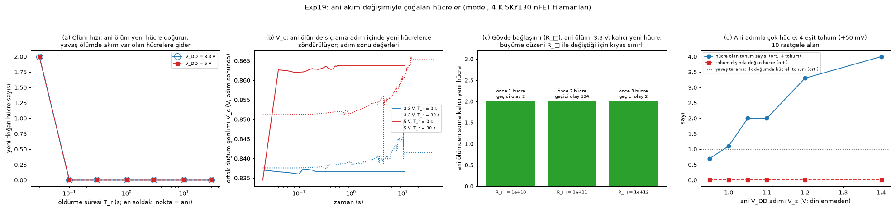

# Deney 19: Ani akım değişimiyle çoğalan hücreler

Tarih: 2026-10-15. Exp18'in ani ölüm (v2) bulgusunun devamı. Exp18 v2'de bir hücre bir anda öldürülünce ortak düğüm gerilimi
sıçramış, en yakın boş sağlam yerlerde yeni hücreler doğmuştu. Model ve aygıt Exp18 ile aynı: 4 K varsayımlı SKY130 nFET filaman
modeli, λ = 60 µm, R_L = 5 kΩ, W = 600 µm.

- **Kod:** `experiments/exp19_pulse/run19.py` (koşular, öngörüler, analiz) ve `figures19.py`.
- **Veri:** `results/exp19/`
  - `predictions.json`: koşulardan önce yazıldı;
  - `runs/` (87 koşu), `analysis.json`, `fig_exp19.png`.

**Deneyler:**
- **A, ölüm hızı:** Exp18'in hedef hücresi −300 mV'luk bantla öldürüldü. Bant 0 (ani), 0,1, 0,3, 1, 3, 10 ve 30 s'lik rampalarla
  verildi, 20 ms'lik adımlarla izlendi. Sürüş 3,3 ve 5,0 V.
- **B, gövde bağlaşımı:** 3,3 V'ta ani ölüm, yanal gövde tabaka direnci R_□ = 10¹⁰, 10¹¹ ve 10¹² Ω/□ ile. Her değer için büyüme
  taraması yeniden yapıldı.
- **C, ani gerilim adımı:** 75, 225, 375 ve 525 µm'de dört eşit tohum (+50 mV, 10 µm). Yavaş tarama (0,02 V/s), dinlenme
  durumundan V_s'ye ani adımlarla karşılaştırıldı. V_s = 0,95–1,4 V; 10 rastgele alan.

## 0. Kısa cevap

1. **Kaç hücre doğacağını ani adımın yüksekliği belirliyor.**
   - Yavaş taramada dört tohumdan hep **bir** tanesi hücre oluyor (10/10, tek kazanan).
   - Aynı aygıta dinlenmeden ani bir adım uygulanınca:
     - V_s ≤ 1,0 V: 1 hücre;
     - V_s = 1,05–1,1 V: 10 alanın 10'unda **tam 2** hücre;
     - V_s = 1,2 V: 3–4 hücre;
     - V_s = 1,4 V: 10 alanın 10'unda **4 tohumun hepsi**.
   - Hiçbir koşuda tohum dışında hücre doğmadı.
2. **Hangi tohumların kazanacağı henüz kontrol edilemiyor.**
   - Ara k değerlerinde kazananlar, aşırı sürüşü en büyük k tohumla 1,05 V'ta 10 alanın yalnız 3'ünde, 1,1 V'ta 2'sinde örtüşüyor.
   - Uçlara yakın tohumlar (75 ve 525 µm) ~%70 kazanıyor, içtekiler ~%30.
   - Yani bu bir "en güçlü k girişi seç" (k-WTA) mekanizması **değil**; konuma bağlı bir seçim var. Bu deneyin ara mesajında 5 alana
     bakıp "büyük olasılıkla k-WTA" demiştim; 10 alanın tamamı bunu desteklemedi.
3. **Ani ölümden sonraki çoğalma yalnız gerçekten ani ölümde oluyor.**
   - Ani öldürme iki sürüşte de 2 yeni hücre doğurdu.
   - Hasar 0,1 s'lik bir rampayla bile verilince yeni doğum sıfır; daha uzun rampalarda da sıfır.
   - Geçiş beklediğimden hızlı, 0,1 s'nin altında. Daha yavaş ölümde akım var olan hücrelere gidiyor (Exp18 v3 ile aynı).
4. **Gövde bağlaşımı:** Üç R_□ değerinde de ani ölümden sonra kalıcı olarak 2 yeni hücre var.
   - Büyüme düzenleri farklı olduğu için (1, 2 ve 3 hücre) bu tam bir kıyas değil.
   - 10¹¹'de ilk 20 ms'de birçok hücre bir an için çevriliyor (124 geçici olay), sonra düzen 2'den 3 hücreye oturuyor.

## 1. Sonuç tabloları

**A, ölüm hızı** (yeni doğan hücre: önceki her hücreden 10 µm'den uzakta beliren hücre sayısı):

| rampa T_r (s) | 0 | 0,1 | 0,3 | 1 | 3 | 10 | 30 |
|---|---|---|---|---|---|---|---|
| 3,3 V | **2** | 0 | 0 | 0 | 0 | 0 | 0 |
| 5,0 V | **2** | 0 | 0 | 0 | 0 | 0 | 0 |

**C, ani adım** (10 alan; tohumlar +50 mV):

| protokol | hücre olan tohum (ort.) | 4 tohumun hepsi | tohum dışında hücre |
|---|---|---|---|
| yavaş tarama | 1,0 (10/10 tam bir) | 0/10 | 0 |
| V_s = 0,95 V | 0,7 | 0/10 | 0 |
| V_s = 1,0 V | 1,1 | 0/10 | 0 |
| V_s = 1,05 V | **2,0 (10/10 tam iki)** | 0/10 | 0 |
| V_s = 1,1 V | **2,0 (10/10 tam iki)** | 0/10 | 0 |
| V_s = 1,2 V | 3,3 | 3/10 | 0 |
| V_s = 1,4 V | **4,0** | **10/10** | 0 |

## 2. Öngörüler: tutan ve tutmayan

| öngörü (koşudan önce) | sonuç |
|---|---|
| A1: doğum sayısı rampa süresiyle artmaz | ✓ (2 → 0) |
| A2: T_r = 0, Exp18 v2'yi tekrarlar (3,3 V: 2; 5,0 V: 3 doğum) | 3,3 V ✓; 5,0 V ✗ (2; v2'de adım 1 s idi, burada 20 ms) |
| A3: doğumun sıfırlandığı en kısa rampa 0,1–10 s arasında | sınırda: zaten 0,1 s'de sıfır, yani geçiş 0,1 s'nin altında |
| B1 (belirsiz hipotez): güçlü bağlaşımda doğum daha az ya da eşit | tam test değil: üçünde de 2, ama büyüme düzenleri farklı |
| C1: yavaş taramada tek tohum (≥ 7/10) | ✓ 10/10 |
| C2: tohum sayısı V_s ile azalmaz; 1,05–1,1 V'ta dördü de (≥ 7/10) | artış ✓; dördü de ✗ (tam iki, 10/10). Dördü ancak 1,4 V'ta |
| C3: 1,4 V'ta tohum dışında da hücre doğar | ✗ hiç doğmadı |
| (sonradan bakıldı) kazananlar = en güçlü k tohum | ✗ 1,05 V'ta 3/10, 1,1 V'ta 2/10; uçtaki tohumlar yeğleniyor |

## 3. Yorum

- **Neden yavaş tarama tek, ani adım çok hücre veriyor?**
  - Yavaş taramada ilk tohum eşiği geçip hücre olunca akımı ortak düğümü düşürüyor; diğerleri eşiğe hiç ulaşamıyor.
  - Ani adımda bütün tohumlar aynı anda eşiğin üstünde başlıyor ve bir yarış oluyor. Bir tohumun hücre olması için, ilk
    hücrelerin akımı ortak düğümü onun eşiğinin altına çekmeden geçişini tamamlaması gerekiyor.
  - Adım ne kadar yüksekse geçişler o kadar hızlı ve o kadar çok tohum yarışı kazanıyor.
  - Arka plandaki hücrelerin eşiği daha yüksek (yaklaşık 1,2–1,3 V); bu yüzden 1,4 V'ta bile tohumlar arka planı geride bırakıyor.
- **Neden ani ölüm çok, yavaş ölüm hiç doğurmuyor?**
  - Ölen hücrenin akımını ya var olan hücreler genişleyerek ya da yeni hücreler alıyor.
  - Genişleme sınırlı bir hızla oluyor. Akım 0,1 s'den daha yavaş serbest kalırsa genişleme yetişiyor ve yeni doğum olmuyor.
- **Ne işe yarayabilir:** **Tek bir ani adımla k hücreyi programlı yerlerde doğurmak**; k, adım yüksekliğiyle ayarlanıyor.
  Yavaş tarama ise her zaman tek hücre veriyor. Bunun bir "çok seviyeli yaz" işlemi olarak kullanılabilmesi için hangi tohumların
  kazanacağının da denetlenmesi gerekiyor. Şu an bu konuma bağlı ve öngörülemiyor.

## 4. Sınırlar

- **Hepsi model.** 4 K varsayımlı indirgenmiş model; ölçüm yok.
- **Zaman ölçekleri varsayıma bağlı.** "0,1 s" gövde kapasitansı c_b ve sızıntı g_sub varsayımlarından geliyor. Gerçek bir aygıtta
  geçiş süresi farklı olabilir.
- **Yük doğrusu anlık.** Ortak düğümde kapasitans yok. Bu, ani adım ve ani ölüm sonuçlarını doğrudan etkileyebilir; sınanmadı.
- **Dar tarama.** Tek tohum yerleşimi (dört eşit tohum, 150 µm aralık), tek λ ve tek R_L; yalnız 10 alan.
- **B kıyası tam değil.** R_□ değişince büyüme sonunda farklı hücre düzenleri oluşuyor.

## 5. Sıradaki adımlar

1. **Kazanan seçimi:** Uç etkisinden arındırılmış bir yerleşim (periyodik ya da uçlardan uzak tohumlar) ve eşit olmayan tohum
   güçleri. Ani adım en güçlü k'yı seçebiliyor mu?
2. **Düğüm kapasitansı:** Ortak düğüme kapasitans ekleyip k–V_s eğrisinin ve ani ölüm doğumlarının nasıl değiştiğini görmek.
3. **Darbe biçimi:** Adım yerine kısa bir darbe (yükselip geri dönen V_DD). Hücreler darbeden sonra yaşıyor mu, k darbe enerjisiyle
   mi yükseklikle mi ayarlanıyor?
